# Compte rendu : Atelier 1, Installation et utilisation de Vagrant

**Étudiant :** Nour Kidoudi
**Formation :** Master DevOps et Cloud Computing, ISET Tozeur
**Matière :** Disponibilité des infrastructures
**Enseignant :** M. Ben Mahmoud
**Date :** 31/10/2026

---

## 1. Objectifs

- Comprendre le rôle de Vagrant dans un workflow DevOps.
- Installer Vagrant et VirtualBox.
- Créer et gérer une machine virtuelle avec un `Vagrantfile`.
- Automatiser la configuration d'une VM (provisioning).
- Déployer une application web simple dans la VM.

## 2. Environnement de travail

Mon poste de travail utilise VMware. Pour ne rien installer sur le PC hôte, tout le TP a été réalisé **dans une VM Ubuntu sous VMware**, avec la virtualisation imbriquée activée. Vagrant et VirtualBox sont installés à l'intérieur de cette VM.

| Élément | Valeur |
|---|---|
| Hyperviseur hôte | VMware |
| VM de travail | Ubuntu (VMware), virtualisation imbriquée activée |
| Hyperviseur imbriqué | VirtualBox |
| Outil | Vagrant |
| Box utilisée | `ubuntu/focal64` |

---

## 3. Partie 1 : Installation

### 3.1 Virtualisation imbriquée

La commande `egrep -c '(vmx|svm)' /proc/cpuinfo` renvoie une valeur supérieure à 0 : la VM Ubuntu peut donc exécuter VirtualBox.

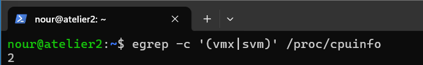

### 3.2 Versions installées

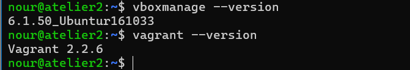

---

## 4. Partie 2 : Création d'une première VM

Commandes utilisées :

```bash
mkdir vagrant-tp && cd vagrant-tp
vagrant init ubuntu/focal64
vagrant up
vagrant ssh
vagrant halt
```

### 4.1 Initialisation du projet

`vagrant init` génère le fichier `Vagrantfile`.

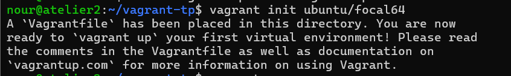

### 4.2 Démarrage de la VM

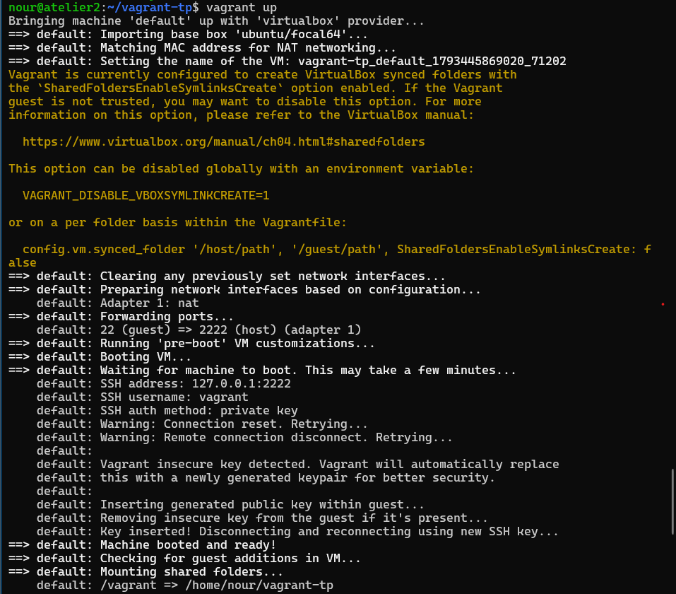

### 4.3 Connexion SSH

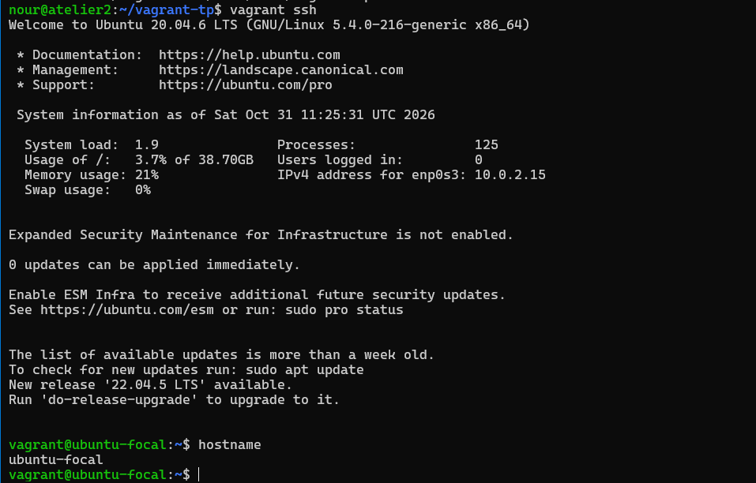

### 4.4 Arrêt de la VM

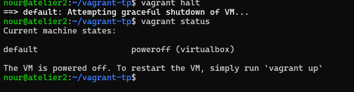

---

## 5. Partie 3 : Modification du Vagrantfile

J'ai défini un nom d'hôte et une adresse IP privée.

```ruby
Vagrant.configure("2") do |config|
  config.vm.box = "ubuntu/focal64"
  config.vm.hostname = "web1"
  config.vm.network "private_network", ip: "192.168.56.10"
end
```

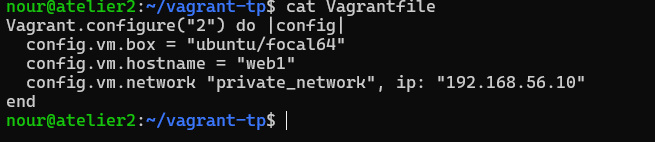

Après `vagrant reload`, l'adresse `192.168.56.10` est bien présente sur l'interface réseau de la VM :

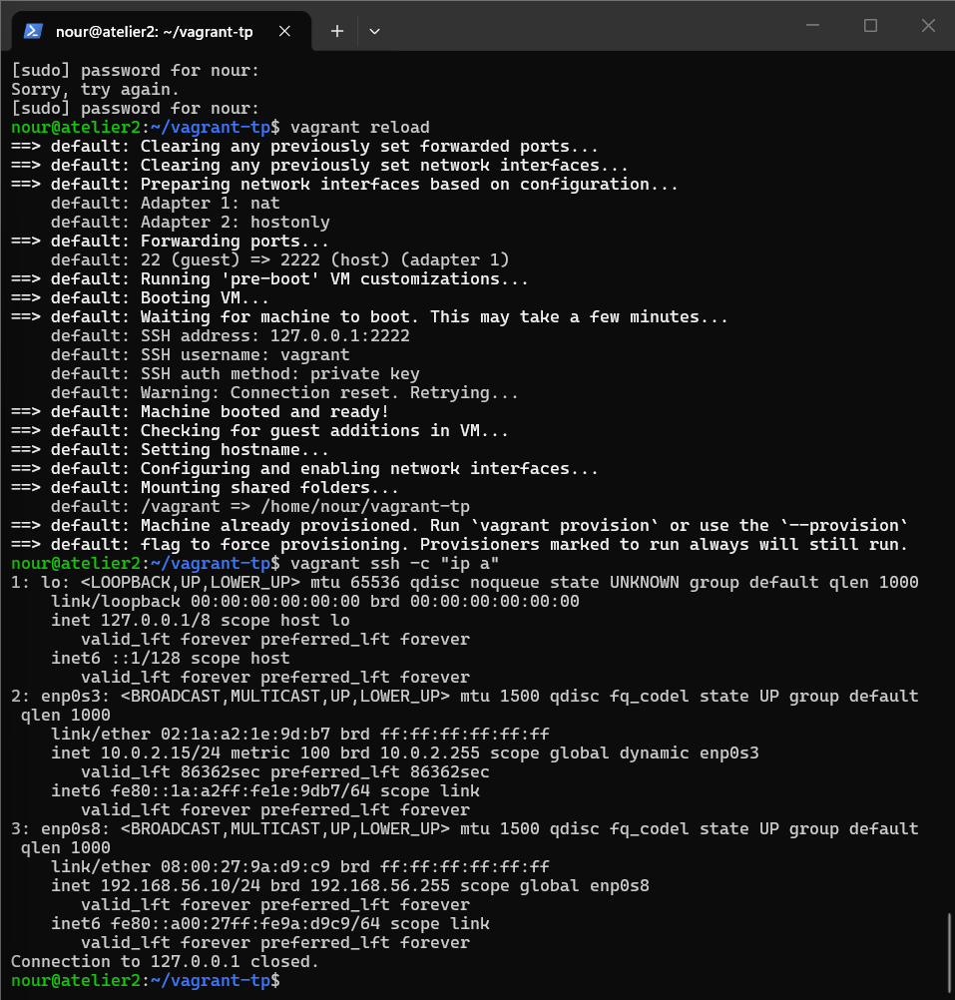

---

## 6. Partie 4 : Provisioning

### 6.1 Script `provision.sh`

```bash
#!/bin/bash
sudo apt update
sudo apt install -y apache2
echo "<h1>Bonjour DevOps avec Vagrant</h1>" | sudo tee /var/www/html/index.html
```

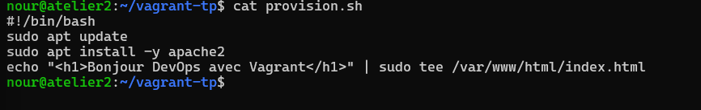

### 6.2 Référence au script dans le Vagrantfile

```ruby
config.vm.provision "shell", path: "provision.sh"
```

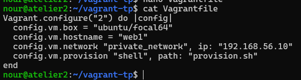

### 6.3 Recréation de la VM

```bash
vagrant destroy -f
vagrant up
```

Le provisioning installe Apache automatiquement au démarrage :

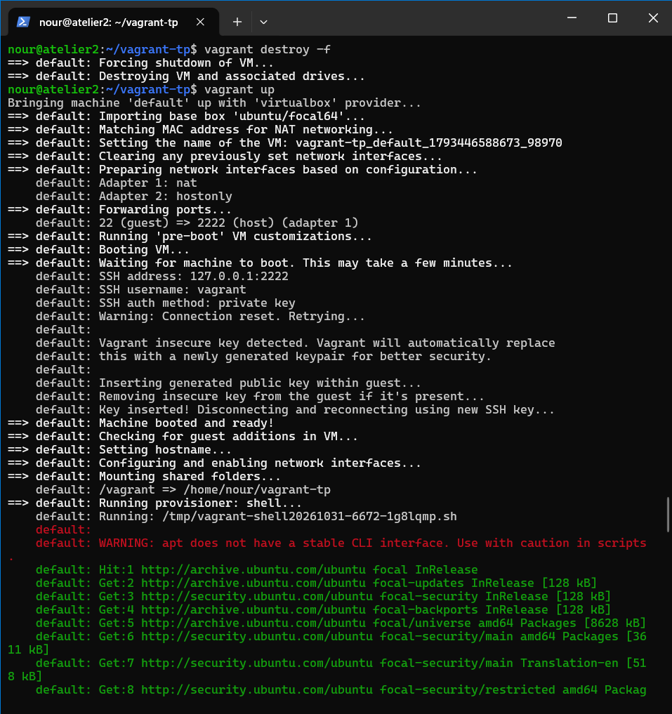

### 6.4 Test de l'application

Test en ligne de commande :

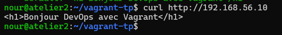

Test dans le navigateur de la VM de travail :


---

## 7. Partie 5 : Exercices

Pour les trois exercices, j'ai utilisé un `Vagrantfile` multi-VM (voir le fichier `Vagrantfile` du dépôt).

```ruby
Vagrant.configure("2") do |config|
  config.vm.box = "ubuntu/focal64"

  config.vm.define "web1" do |web1|
    web1.vm.hostname = "web1"
    web1.vm.network "private_network", ip: "192.168.56.10"
    web1.vm.network "forwarded_port", guest: 80, host: 8080
    web1.vm.provision "shell", path: "provision.sh"
    web1.vm.provision "shell", inline: <<-SHELL
      sudo apt install -y php libapache2-mod-php
      echo "<?php phpinfo(); ?>" | sudo tee /var/www/html/index.php
      sudo systemctl restart apache2
    SHELL
  end

  config.vm.define "web2" do |web2|
    web2.vm.hostname = "web2"
    web2.vm.network "private_network", ip: "192.168.56.11"
    web2.vm.provision "shell", inline: <<-SHELL
      sudo apt update
      sudo apt install -y nginx
    SHELL
  end
end
```

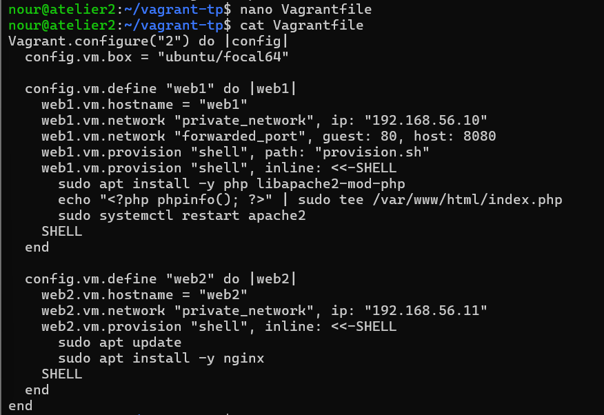

### 7.1 Exercice a : deuxième serveur nginx (192.168.56.11)

Les deux machines `web1` et `web2` sont en cours d'exécution :

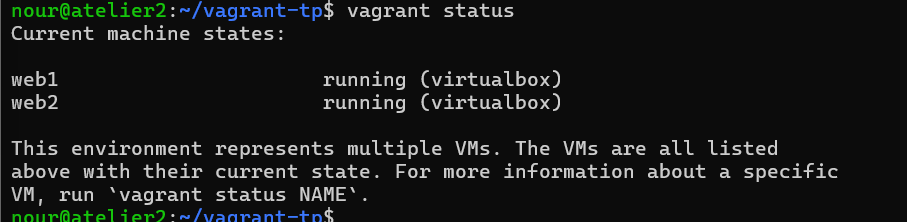

Le serveur `web2` répond avec la page nginx :

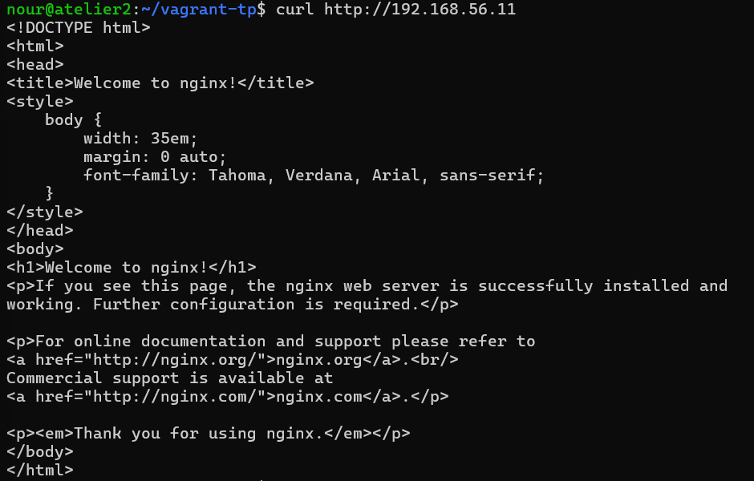

### 7.2 Exercice b : port forwarding vers `localhost:8080`

Le port 80 de `web1` est redirigé vers le port 8080 de la VM de travail :


### 7.3 Exercice c : PHP

Le fichier `index.php` affiche la page `phpinfo()`, ce qui confirme que PHP est installé et fonctionne avec Apache :

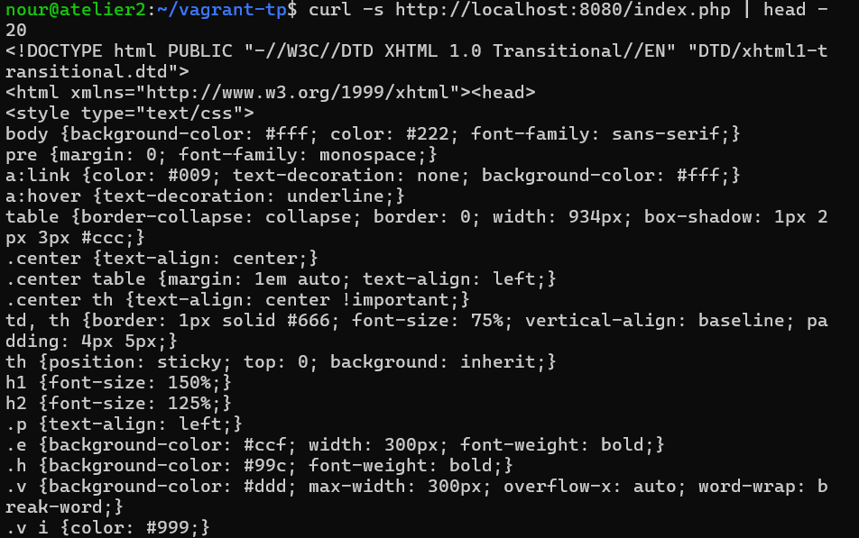

### 7.4 Vue d'ensemble des VM VirtualBox

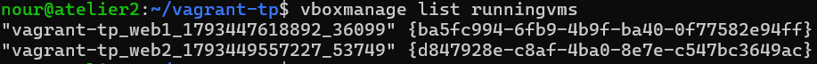

---

## 8. Résultats

| Objectif | Résultat |
|---|---|
| Installation de Vagrant et VirtualBox | Réalisée (captures 01 et 02) |
| Création et gestion d'une VM | Réalisée (captures 03 à 06) |
| Modification du Vagrantfile (IP privée) | Réalisée (captures 07 et 08) |
| Provisioning automatique d'Apache | Réalisé (captures 09 à 13) |
| Exercice a : serveur nginx | Réalisé (captures 15 et 16) |
| Exercice b : port forwarding 8080 | Réalisé (capture 17) |
| Exercice c : PHP | Réalisé (capture 18) |

## 9. Difficultés rencontrées

> À compléter avec tes vrais problèmes (exemples : erreur de plage d'IP VirtualBox résolue avec `/etc/vbox/networks.conf`, manque de RAM de la VM de travail, Secure Boot, lenteur du téléchargement de la box).

## 10. Conclusion

Vagrant permet de décrire une machine virtuelle dans un simple fichier et de la recréer à l'identique avec `vagrant up`. Le provisioning supprime les installations manuelles : un environnement complet (Apache, PHP, nginx) est prêt en une commande. Cette approche rend les environnements reproductibles et partageables, ce qui est au cœur du workflow DevOps.

## 11. Contenu du dépôt

```
.
├── README.md
├── Vagrantfile
├── provision.sh
└── captures/
    ├── 01-nested-virt.png
    ├── 02-versions.png
    ├── ...
    └── 19-virtualbox-list.png
```
